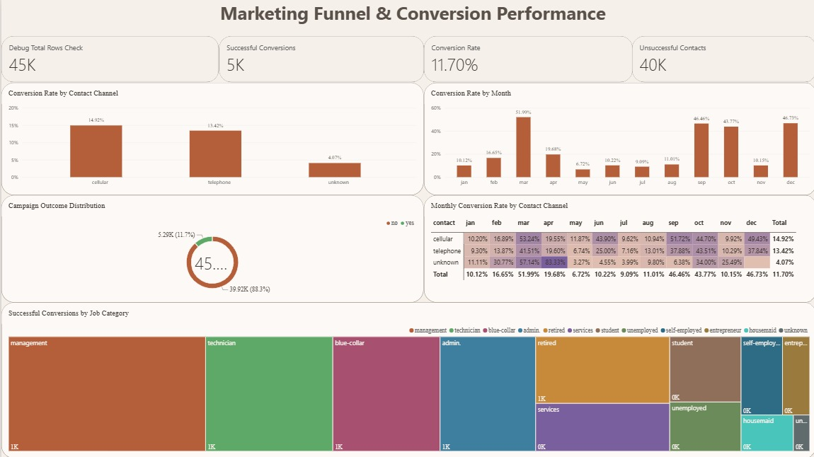
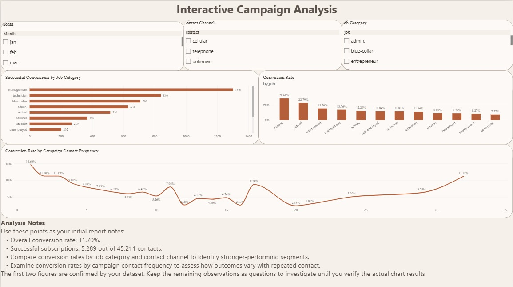

# Marketing Funnel & Conversion Performance Analysis

A data analytics project built with **Microsoft Power BI** to analyze direct-marketing campaign outcomes, subscription conversion rates, and customer segments using the UCI Bank Marketing dataset.

## 📌 Project Overview

This project examines direct-marketing contacts and whether customers subscribed to a bank term deposit. An interactive Power BI report presents campaign performance through KPI cards, charts, a monthly conversion heatmap, and slicers.

**Note:** This is a direct-marketing campaign analysis, not a website visitor-to-customer funnel.

## 🎯 Objectives

- Measure total contacts and successful and unsuccessful subscriptions.
- Calculate the overall conversion rate.
- Compare conversion rates by contact channel and month.
- Analyze subscription outcomes across job categories.
- Explore conversion performance by campaign contact frequency.
- Build an interactive report for campaign performance analysis.

## 🛠️ Tools & Technologies

- Microsoft Power BI Desktop
- Power Query
- DAX
- GitHub

## 📂 Dataset

**Source:** [UCI Machine Learning Repository — Bank Marketing](https://archive.ics.uci.edu/dataset/222/bank+marketing)

**File analyzed:** `bank-full.csv`

- Records: 45,211
- Original columns: 17
- Target variable: `y` — whether the customer subscribed to a term deposit (`yes` or `no`)

## 📊 Key Performance Indicators

| Metric | Result |
|---|---:|
| Total Contacts | 45,211 |
| Successful Subscriptions | 5,289 |
| Unsuccessful Contacts | 39,922 |
| Overall Conversion Rate | 11.70% |

Conversion rate is calculated as successful subscriptions divided by total contacts.

## 📈 Dashboard Features

### Page 1 — Marketing Performance Overview
- KPI cards
- Conversion rate by contact channel
- Monthly conversion trend
- Campaign outcome distribution
- Successful conversions by job category
- Monthly conversion-rate matrix by contact channel

### Page 2 — Campaign Analysis
- Month, contact-channel, and job-category slicers
- Successful conversions by job category
- Conversion rate by job category
- Conversion rate by campaign contact frequency
- Analysis notes

## 🖼️ Dashboard Screenshots

### Page 1 — Marketing Performance Overview

### Page 2 — Campaign Analysis

## 🔍 Methodology

1. Imported `bank-full.csv` into Power BI.
2. Prepared and checked data types using Power Query.
3. Created DAX measures for total contacts, successful subscriptions, unsuccessful contacts, and conversion rate.
4. Created a month lookup table to display months in calendar order.
5. Built visualizations and slicers for segment-level analysis.
6. Reviewed the overall KPI figures against the full dataset.

## 💡 Key Findings

The dataset contains 45,211 marketing contacts, of which 5,289 resulted in a term-deposit subscription. The overall conversion rate is approximately 11.70%.

The dashboard supports further investigation of differences across contact channels, months, job categories, and campaign contact frequency. Specific segment-level recommendations should be based on the observed visual results.

## 🚀 How to View the Report

1. Download `Marketing_Funnel_Conversion_Analysis.pbix` from this repository.
2. Open it in Microsoft Power BI Desktop.
3. Explore both report pages and use the slicers to investigate different segments.

## ⚠️ Disclaimer

This project is for educational and portfolio purposes. It uses the UCI Bank Marketing dataset and does not represent a live banking campaign.
